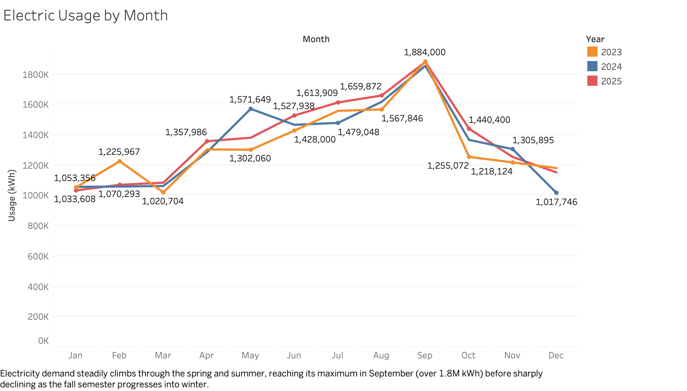
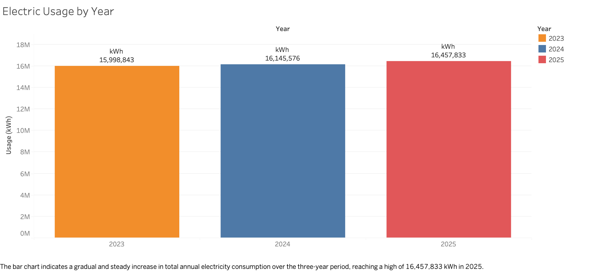
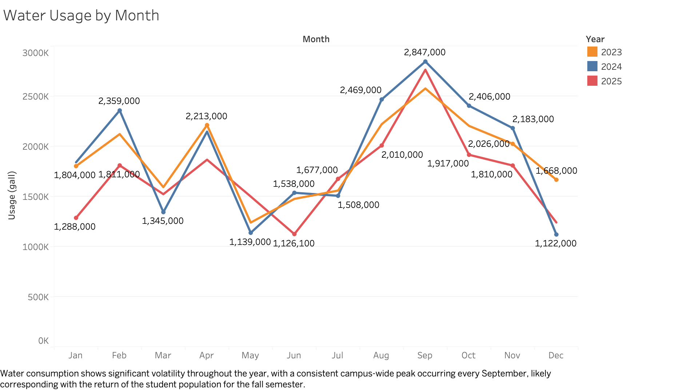
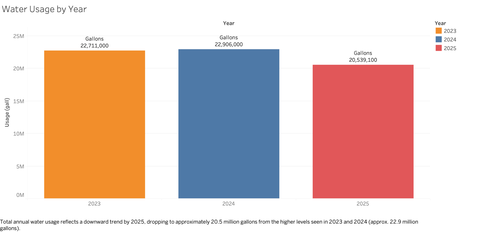
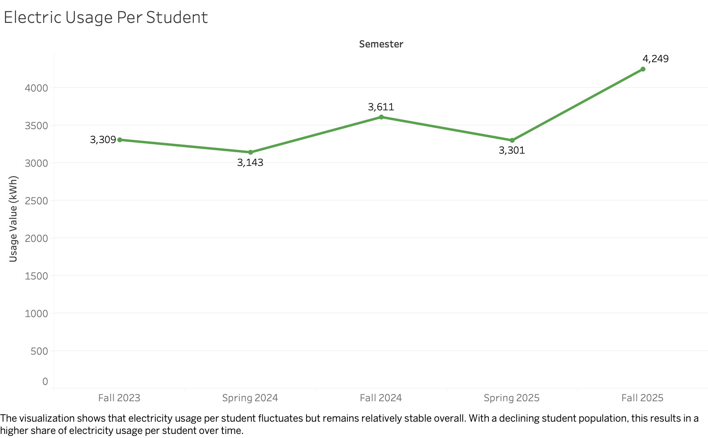
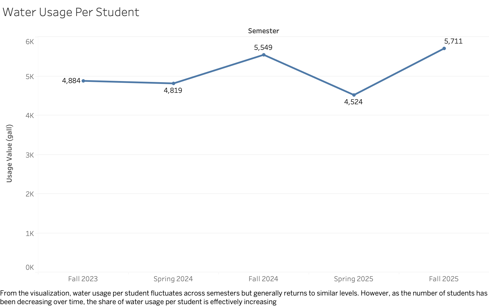
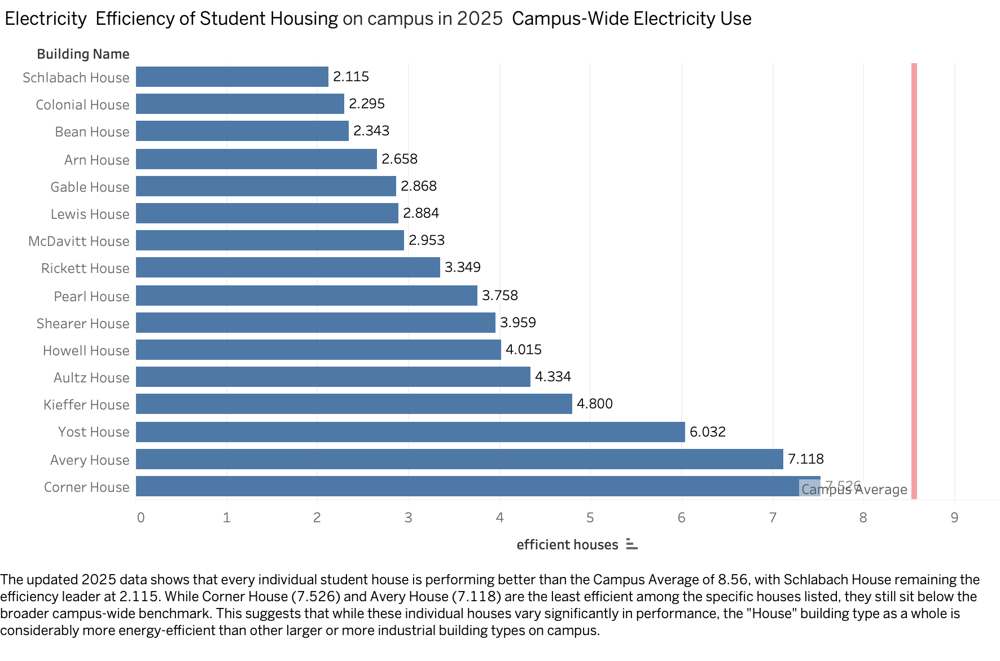

# Sustainability Analysis Report

## Project Overview

This project was developed for **The College of Wooster** using utility and facilities data provided by the college. The goal was to turn detailed operational records into clear, useful visualizations that explain energy consumption, compare building efficiency, and identify opportunities for more sustainable campus operations.

The work involved **cleaning and organizing Excel data**, preparing consistent time periods and calculation fields, checking values against source records, and developing Tableau visualizations for electricity, water, student-normalized utility use, and student housing efficiency. The analyses provide an accessible overview of campus resource usage and practical areas for further investigation.

The campus electricity and water analyses cover **2023–2025**. The student housing efficiency comparison focuses on **2025**.

## Project Approach

- **Data preparation:** Cleaned and reorganized the supplied Excel records, standardized time categories, and prepared datasets for analysis in Tableau.
- **Data transformation:** Developed monthly and annual comparisons, semester-level usage-per-student measures, and building-level electricity efficiency metrics.
- **Visualization design:** Used time-series charts and bar charts to communicate trends, comparisons, and outliers.
- **Validation:** Cross-checked selected values and trends displayed in Tableau against the underlying Excel records, refining labels, filters, and annotations for clarity.
- **Communication:** Summarized findings and recommendations relevant to the college's sustainability goals.

## Supporting Tableau Analyses

### 1. Campus Utility Consumption — https://public.tableau.com/app/profile/atabek.rysbekov/viz/CampusUtilityConsumption/WaterUsagebyMonth

This workbook compares campus electricity and water consumption across **2023–2025**, using monthly trends and annual totals to show seasonal and longer-term changes.

#### Electric Usage by Month

Monthly electricity usage generally increases during spring and summer before peaking in **September at approximately 1.9 million kWh**. The repeated peak suggests that seasonal conditions and campus activity may both contribute to electricity demand.

#### Electric Usage by Year

Annual electricity use rose from **15,998,843 kWh in 2023** to **16,457,833 kWh in 2025**, indicating a modest increase in overall campus electricity demand.

#### Water Usage by Month

Water usage varies considerably throughout the year, with recurring peaks in **September**. These fluctuations may reflect changes in campus occupancy and operations, although the chart alone cannot isolate their causes.

#### Water Usage by Year

Annual water consumption declined to **20,539,100 gallons in 2025**, compared with **22,906,000 gallons in 2024**. The lower 2025 total contrasts with the modest increase in annual electricity use.

---

### 2. Utility Usage per Student — https://public.tableau.com/app/profile/atabek.rysbekov/viz/UtilityUsagePerStudent/WaterUsagePerStudent

These charts normalize campus-wide consumption by student enrollment to support comparisons across semesters with different student populations. **They should not be interpreted as individual students' actual metered usage.**

#### Electric Usage per Student

The calculated electricity usage per student fluctuates across semesters but increases from **3,309 kWh in Fall 2023** to **4,249 kWh in Fall 2025**. This adds context to changes in total electricity consumption.

#### Water Usage per Student

Water usage per student varies across semesters, from **4,524 gallons in Spring 2025** to **5,711 gallons in Fall 2025** in the displayed period. The changes show why both total demand and enrollment-adjusted measures are helpful when interpreting utility trends.

---

### 3. Housing vs. Campus Electricity Efficiency — https://public.tableau.com/app/profile/atabek.rysbekov/viz/Housingvs_CampusElectricityEfficiency/HousingVSWholeCampus

#### Student Housing Efficiency Compared with the Campus Average

This comparison ranks the electricity-use efficiency measure for student houses in **2025** against a **campus-wide benchmark of 8.56**. **Schlabach House (2.115)** has the lowest measured value among the listed houses, while **Corner House (7.526)** has the highest. All listed houses fall below the campus benchmark, suggesting opportunities to investigate why electricity intensity differs across buildings.

---

## Key Findings

- **Electricity:** Total annual consumption increased modestly over the three-year period, with a recurring September peak.
- **Water:** Annual consumption was lower in 2025 than in 2023 or 2024.
- **Student housing:** Electricity-use intensity varies considerably by building, making targeted investigation more useful than treating all residences as equally efficient.

## Recommendations and Limitations

The analysis points to potential opportunities in **building-level electricity audits** and **continued monitoring of water and electricity trends**. Useful next steps would include relating utility usage to outdoor temperature, building size and condition, operational schedules, and actual campus occupancy.

The findings are descriptive rather than causal. Student-normalized values are based on campus-wide totals, building-level data may be incomplete, and weather and facility characteristics were not fully controlled for.

## Data Source and Tools

- **Data source:** Campus utilities, student enrollment, and facilities records supplied by **The College of Wooster** for this project.
- **Tools:** Microsoft Excel for data cleaning and preparation; Tableau for calculations and chart development.
- **Data availability:** Standalone original and processed college datasets are not included in this repository. The packaged Tableau workbooks may contain embedded source data; redistribution requires the college's applicable permission. This repository contains visualization images and links to the corresponding Tableau Public views.
