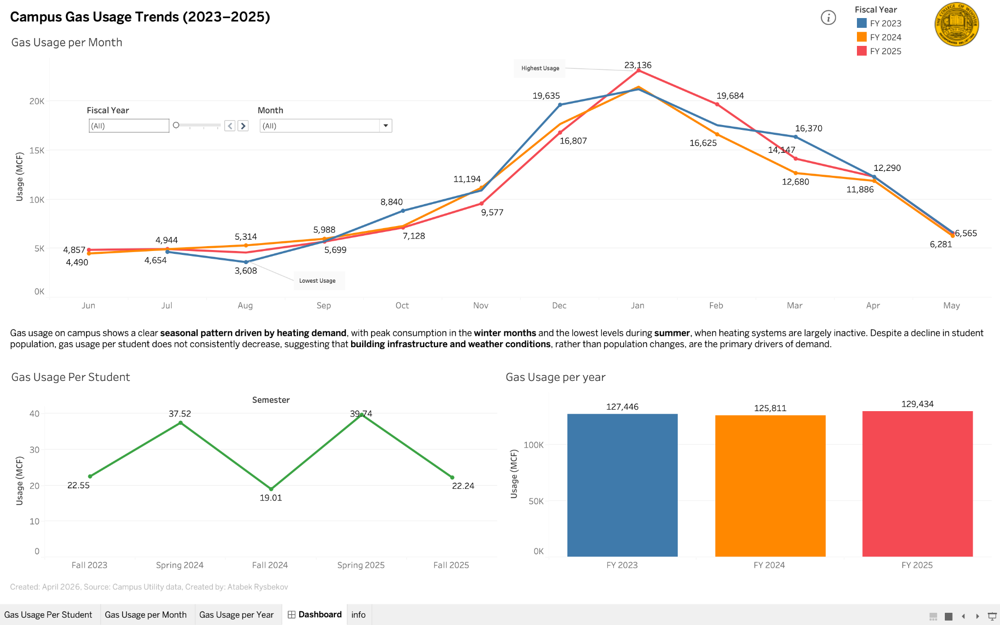
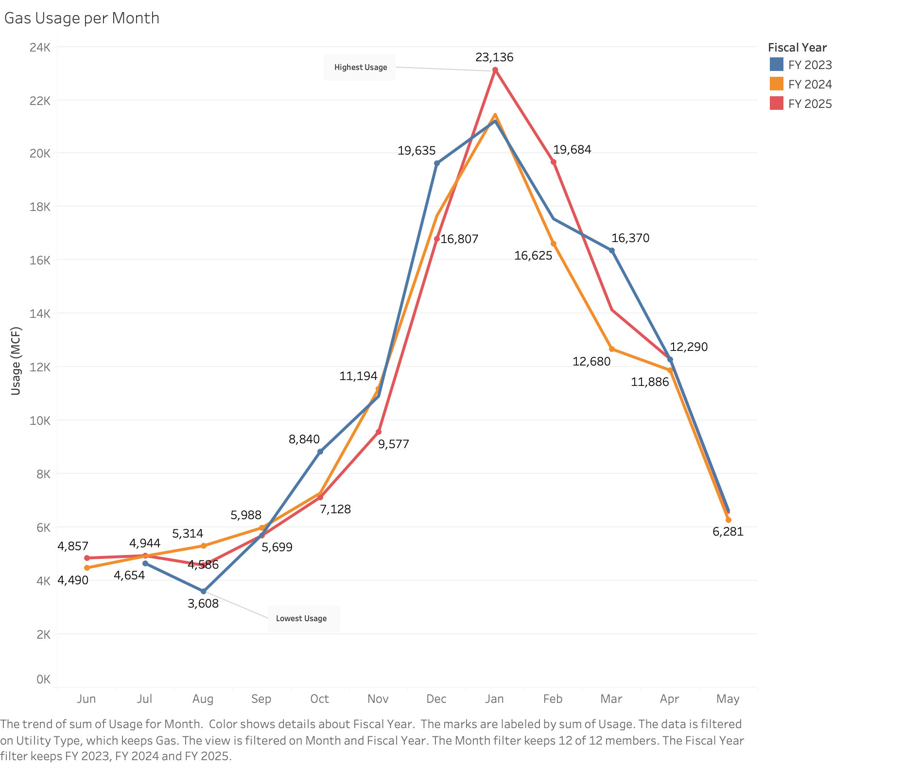
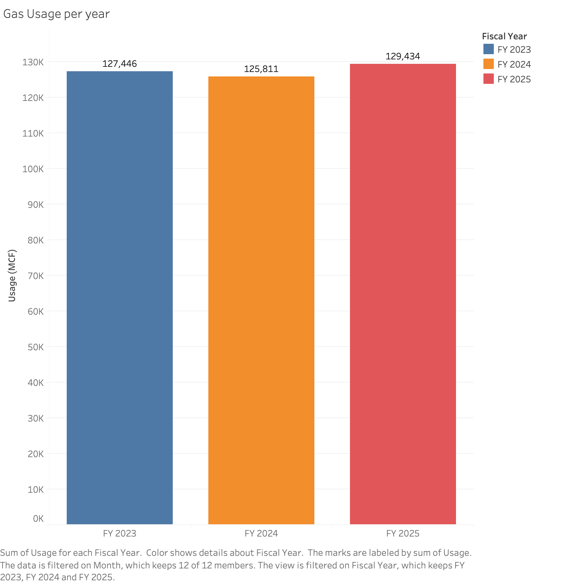
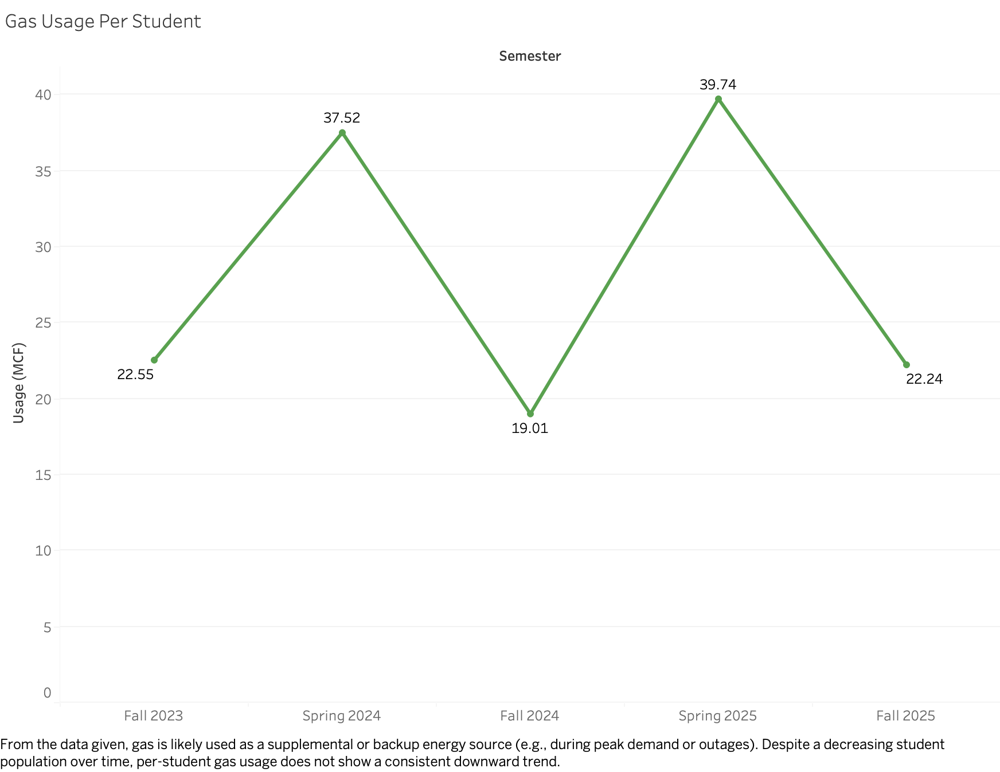
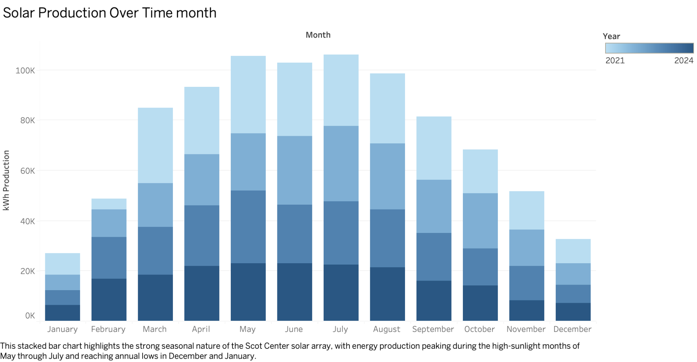
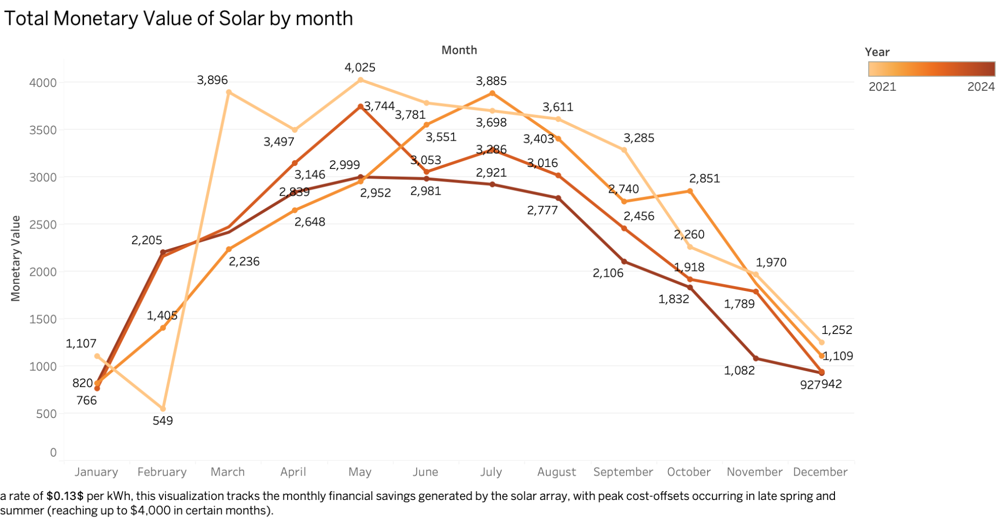
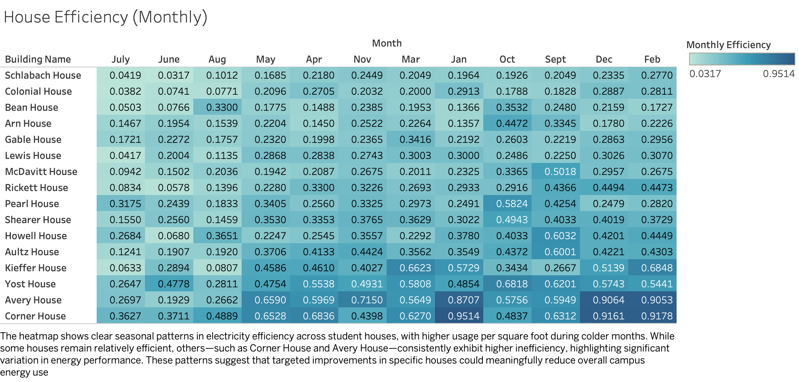

# Campus Utility Consumption & Sustainability Analysis

## Project Overview

This project was developed for **The College of Wooster** using utility and facilities data provided by the college. The goal was to turn detailed operational records into clear, useful visualizations that explain energy consumption, compare building efficiency, and identify opportunities for more sustainable campus operations.

The work involved **cleaning and organizing Excel data**, preparing consistent time periods and calculation fields, checking values against source records, and developing Tableau visualizations for electricity, natural gas, water, student-normalized utility use, student housing efficiency, and solar energy production. The exploratory analyses supported a **final interactive Tableau dashboard focused on campus natural gas consumption**. Together, the visualizations and findings provide an accessible overview of campus resource usage and practical areas for further investigation.

The campus utility analyses primarily cover **2023–2026**; the student housing efficiency comparison focuses on **2025**, while the Scot Center solar analysis covers **2021–2024**.

## Project Approach

- **Data preparation:** Cleaned and reorganized the supplied Excel records, standardized time categories, and prepared datasets for analysis in Tableau.
- **Data transformation:** Developed monthly and annual comparisons, semester-level usage-per-student measures, and building-level electricity efficiency metrics. Kept fiscal-year analysis distinct from calendar-year analysis.
- **Visualization design:** Used time-series charts, bar charts, and a heatmap to communicate trends, comparisons, and outliers.
- **Validation:** Cross-checked selected values and trends displayed in Tableau against the underlying Excel records, refining labels, filters, and annotations for clarity.
- **Communication:** Summarized findings and recommendations relevant to the college's sustainability goals.

## Final Interactive Dashboard

### Campus Gas Consumption Dashboard — https://public.tableau.com/app/profile/atabek.rysbekov/viz/CampusGasConsumptionDashboard/Dashboard

The final dashboard brings together three perspectives on campus natural gas consumption: **monthly usage (MCF)**, **annual totals by fiscal year**, and **usage per student by semester**. It is designed to show both the strong seasonal cycle in heating-related gas demand and the extent to which overall usage changes across fiscal years.

**How to use the dashboard:** Use the **Fiscal Year** control to focus on a particular year and the **Month** dropdown to narrow the period being viewed. Hover over chart marks to inspect values. The monthly time series follows the college's fiscal-year sequence (**June–May**), while the lower charts add annual and student-normalized context.

**Main insight:** Gas consumption is highest in the colder months and substantially lower in summer. Annual gas use remained fairly similar across FY 2023–FY 2025, suggesting that seasonal heating demand is a stronger visible pattern than a consistent year-to-year decline.

#### Gas Usage per Month

Gas usage rises sharply from autumn into winter, with the highest plotted monthly value reaching **23,136 MCF in January of FY 2025**. The comparison across three fiscal years emphasizes the recurring seasonal demand.

#### Gas Usage per Year

Annual gas consumption stayed relatively stable: **127,446 MCF in FY 2023**, **125,811 MCF in FY 2024**, and **129,434 MCF in FY 2025**. Despite fluctuations during individual months, there was no sustained decrease over the period.

#### Gas Usage per Student

The semester-level measure fluctuates substantially, with higher values in spring semesters. It provides an enrollment-adjusted comparison, but it does **not** represent direct gas metering for individual students; campus-wide gas consumption also supports buildings and operations beyond student residences.

---

## Supporting Tableau Analyses

### 1. Campus Utility Consumption — https://public.tableau.com/app/profile/atabek.rysbekov/viz/CampusUtilityConsumption/WaterUsagebyMonth

This workbook compares campus electricity and water consumption across **2023–2025**, using monthly trends and annual totals to show seasonal and longer-term changes.

#### Electric Usage by Month

Monthly electricity usage generally increases during spring and summer before peaking in **September at approximately 1.9 million kWh**. The repeated peak suggests that seasonal conditions and campus activity may both contribute to electricity demand.

#### Electric Usage by Year

Annual electricity use rose from **15,998,843 kWh in 2023** to **16,457,833 kWh in 2025**, indicating a modest increase in overall campus electricity demand.

#### Water Usage by Month

Water usage varies considerably throughout the year, with recurring peaks in **September**. These fluctuations may reflect changes in campus occupancy and operations, although the chart alone cannot isolate their causes.

#### Water Usage by Year

Annual water consumption declined to **20,539,100 gallons in 2025**, compared with **22,906,000 gallons in 2024**. The lower 2025 total contrasts with the modest increase in annual electricity use.

---

### 2. Utility Usage per Student — https://public.tableau.com/app/profile/atabek.rysbekov/viz/UtilityUsagePerStudent/WaterUsagePerStudent

These charts normalize campus-wide consumption by student enrollment to support comparisons across semesters with different student populations. **They should not be interpreted as individual students' actual metered usage.**

#### Electric Usage per Student

The calculated electricity usage per student fluctuates across semesters but increases from **3,309 kWh in Fall 2023** to **4,249 kWh in Fall 2025**. This adds context to changes in total electricity consumption.

#### Water Usage per Student

Water usage per student varies across semesters, from **4,524 gallons in Spring 2025** to **5,711 gallons in Fall 2025** in the displayed period. The changes show why both total demand and enrollment-adjusted measures are helpful when interpreting utility trends.

---

### 3. Housing vs. Campus Electricity Efficiency — https://public.tableau.com/app/profile/atabek.rysbekov/viz/Housingvs_CampusElectricityEfficiency/HousingVSWholeCampus

#### Student Housing Efficiency Compared with the Campus Average

This comparison ranks the electricity-use efficiency measure for student houses in **2025** against a **campus-wide benchmark of 8.56**. **Schlabach House (2.115)** has the lowest measured value among the listed houses, while **Corner House (7.526)** has the highest. All listed houses fall below the campus benchmark, suggesting opportunities to investigate why electricity intensity differs across buildings.

---

### 4. Campus Solar Energy Analysis — https://public.tableau.com/app/profile/atabek.rysbekov/viz/CampusSolarEnergyAnalysis/SolarProductionMonth

This workbook explores the Scot Center solar array's electricity production and the *estimated* monetary value of that output across **2021–2024**.

#### Solar Production by Month

Solar production follows a clear seasonal pattern, with the strongest output generally occurring from **May through July** and much lower production in **December and January**.

#### Estimated Monetary Value of Solar Production by Month

The visualization translates solar generation into an illustrative financial value using an **assumed rate of $0.13 per kWh**. Some high-output months approach **$4,000 in estimated value**. These figures are modeled offsets, **not verified electricity-bill savings**.

---

### 5. Monthly Housing Electricity Efficiency — https://public.tableau.com/app/profile/atabek.rysbekov/viz/MonthlyHousingElectricityEfficiency/HouseEfficiencyMonthly

#### House Efficiency by Month

The heatmap compares monthly electricity-use intensity across student houses. Darker cells represent **higher values of the project's calculated efficiency measure**. Houses such as **Corner House and Avery House** frequently show comparatively high values, suggesting that more detailed energy audits could help identify possible efficiency improvements.

---

## Key Findings

- **Natural gas:** Demand rises substantially in the winter, while annual consumption remained relatively stable from FY 2023 to FY 2025.
- **Electricity:** Total annual consumption increased modestly over the three-year period, with a recurring September peak.
- **Water:** Annual consumption was lower in 2025 than in 2023 or 2024.
- **Student housing:** Electricity-use intensity varies considerably by building, making targeted investigation more useful than treating all residences as equally efficient.
- **Solar energy:** Production is concentrated in sunnier months, creating seasonal opportunities to offset purchased electricity.

## Recommendations and Limitations

The analysis points to potential opportunities in **winter heating efficiency**, **building-level electricity audits**, and **continued monitoring of water and electricity trends**. Useful next steps would include relating utility usage to outdoor temperature, building size and condition, operational schedules, and actual campus occupancy.

The findings are descriptive rather than causal. Student-normalized values are based on campus-wide totals, building-level data may be incomplete, and weather and facility characteristics were not fully controlled for. Solar financial estimates use a fixed assumed electricity price rather than the college's verified billing rate.

## Data Source and Tools

- **Data source:** Campus utilities, student enrollment, facilities, and solar-production records supplied by **The College of Wooster** for this project.
- **Tools:** Microsoft Excel for data cleaning and preparation; Tableau for calculations, charts, and interactive dashboard development.
- **Data availability:** The original and processed college datasets are **not included** in this repository. Redistribution requires the college's applicable permission. This repository contains visualization images and links to the corresponding Tableau Public views.
